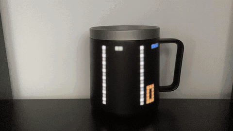
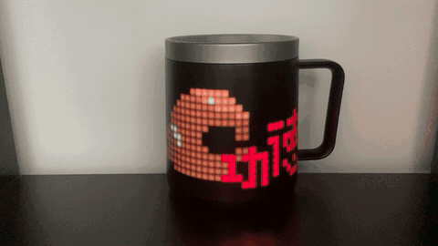
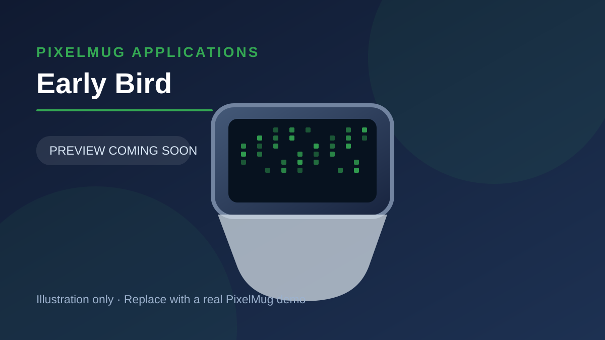
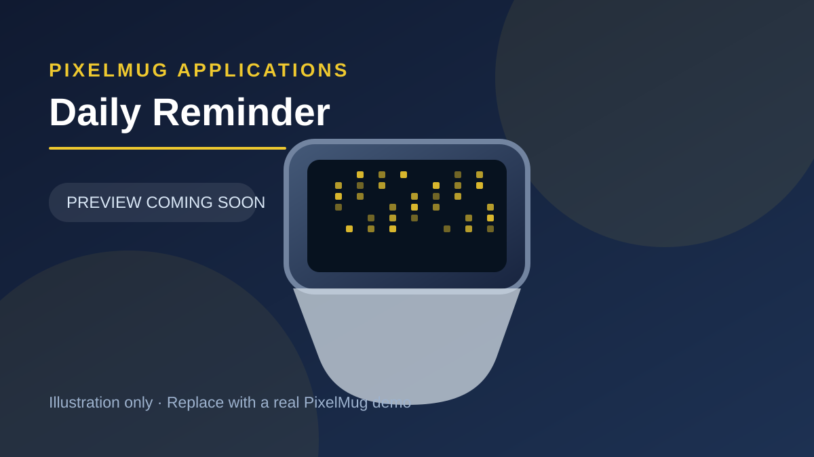
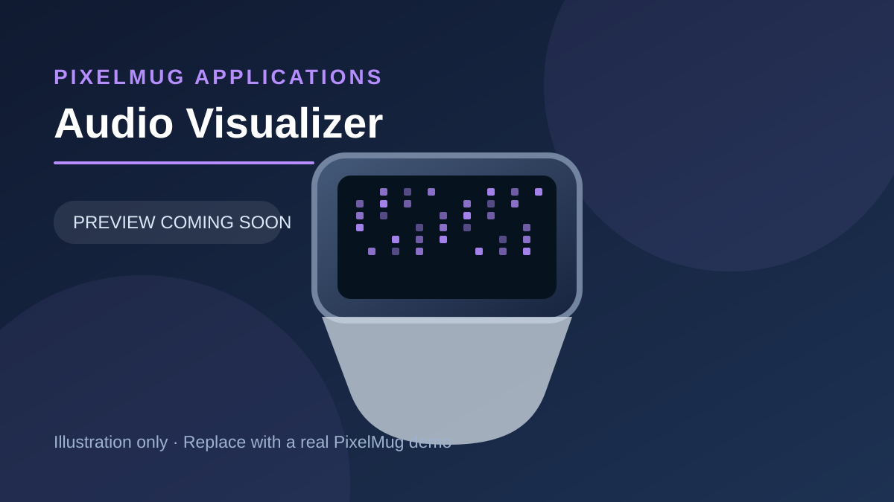
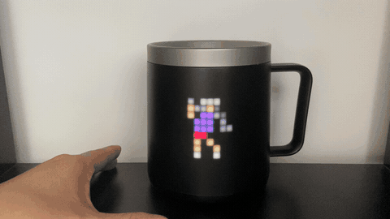
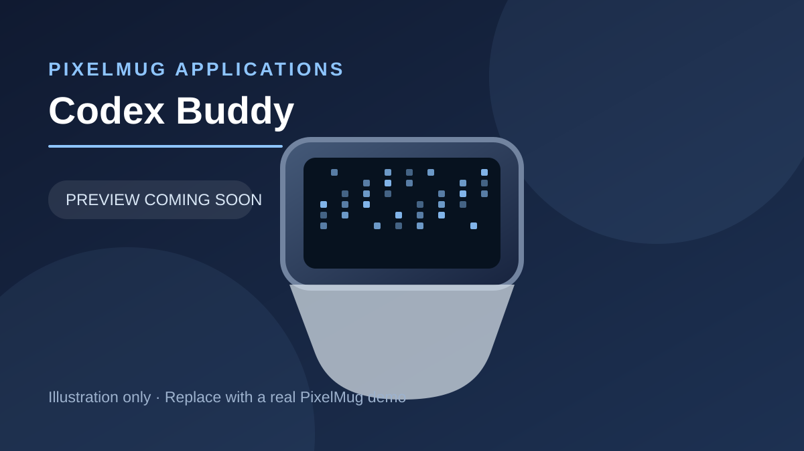

# PixelMug App Gallery

Discover, play, and build open-source applications for PixelMug. Each project below is a complete application with its own source repository.

[Explore the developer docs](https://bubble-pixelmug.github.io/pixelmug-docs/) · [Get PixelMug Studio](https://github.com/bubble-pixelmug/pixelmug-studio) · [Browse all repositories](https://github.com/orgs/pixelmug-applications/repositories)

> SVG covers are illustrative placeholders. Animated covers show application previews.

## Games

<table>
<tr>
<td width="50%" valign="top"> <strong>Block Drop</strong> Guide falling blocks from a BLE WebApp controller. <a href="https://github.com/pixelmug-applications/block-drop">Source</a></td>
<td width="50%" valign="top"> <strong>Block Drop Battle</strong> Two players, two PixelMugs, one group leaderboard. <a href="https://github.com/pixelmug-applications/block-drop-battle">Source</a></td>
</tr>
<tr>
<td width="50%" valign="top"> <strong>Duck Hunt</strong> Use your phone as a BLE sight for a PixelMug arcade game. <a href="https://github.com/pixelmug-applications/duck-hunt">Source</a></td>
<td width="50%" valign="top"> <strong>Party Games</strong> Flip coins, roll dice, spin a wheel, and play together. <a href="https://github.com/pixelmug-applications/party-games">Source</a></td>
</tr>
<tr>
<td width="50%" valign="top"> <strong>Cyber Woodfish</strong> Tap a digital woodfish and keep your stats on the device. <a href="https://github.com/pixelmug-applications/cyber-woodfish">Source</a></td>
<td width="50%" valign="top"> <strong>Dino Runner</strong> Jump over obstacles on PixelMug and beat your best score. <a href="https://github.com/pixelmug-applications/dino-runner">Source</a></td>
</tr>
<tr>
<td width="50%" valign="top"> <strong>Early Bird</strong> Tap to fly, eat bugs, dodge eagles, and beat your best score on PixelMug. <a href="https://github.com/pixelmug-applications/early-bird">Source</a></td>
<td width="50%" valign="top"></td>
</tr>
</table>

## Everyday

<table>
<tr>
<td width="50%" valign="top"> <strong>Ambient Clock</strong> Three clock styles with ticking sounds and ambient audio. <a href="https://github.com/pixelmug-applications/ambient-clock">Source</a></td>
<td width="50%" valign="top"> <strong>Pomodoro Timer</strong> Focus and break cycles that run directly on PixelMug. <a href="https://github.com/pixelmug-applications/pomodoro">Source</a></td>
</tr>
<tr>
<td width="50%" valign="top"> <strong>Message Board</strong> Send chat messages to a PixelMug display through a Bot. <a href="https://github.com/pixelmug-applications/message-board">Source</a></td>
<td width="50%" valign="top"> <strong>Daily Reminder</strong> Edit today's schedule and sync it to PixelMug for a timeline and sound reminders. <a href="https://github.com/pixelmug-applications/daily-reminder">Source</a></td>
</tr>
</table>

## Creative

<table>
<tr>
<td width="50%" valign="top"> <strong>Audio Visualizer</strong> Explore audio spectra and network music on PixelMug. <a href="https://github.com/pixelmug-applications/audio-visualizer">Source</a></td>
<td width="50%" valign="top"> <strong>Emoji Magnet</strong> Shake emoji into particles and watch them reform. <a href="https://github.com/pixelmug-applications/emoji-magnet">Source</a></td>
</tr>
</table>

## Developer Tools

<table>
<tr>
<td width="50%" valign="top"> <strong>Codex Buddy</strong> Show Codex activity on PixelMug with a desktop companion. <a href="https://github.com/pixelmug-applications/codex-buddy">Source</a></td>
<td width="50%" valign="top"></td>
</tr>
</table>

## Build and share your own

Start with the [PixelMug developer docs](https://bubble-pixelmug.github.io/pixelmug-docs/) and [PixelMug Studio](https://github.com/bubble-pixelmug/pixelmug-studio). If you have a complete open-source application to share, propose it through the [gallery repository](https://github.com/pixelmug-applications/.github). Each application remains independently maintained in its own repository.
